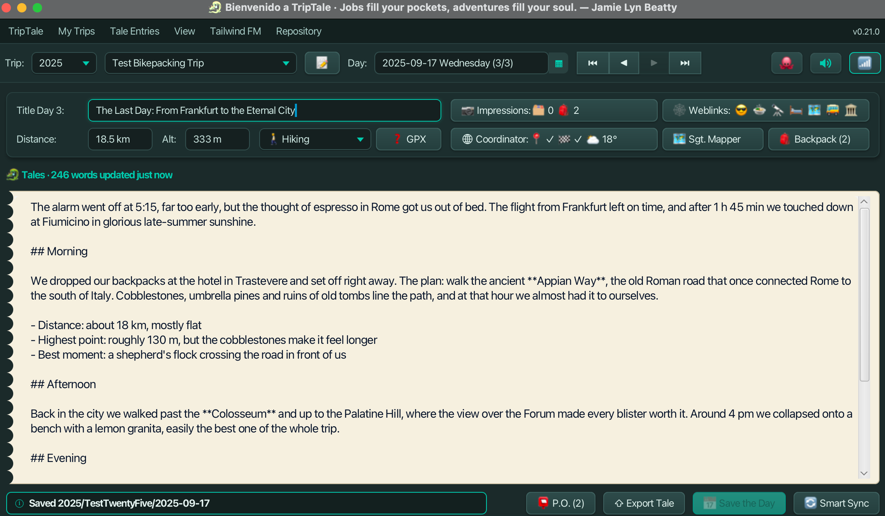

# TripTale 🏔️🚴


> An offline-first diary for long cycling and hiking trips — your notes live as plain Markdown in a git repo you own.

TripTale is a small JavaFX app for keeping a day-by-day journal of a trip: kilometres ridden, altitude climbed, where you started and stopped, and whatever notes you want to scribble. The twist: no account, no database, and no cloud unless you want one. Every entry is a plain Markdown file on disk, and the whole thing is a git repository — so you can sync between machines, hack it from the command line, or never touch the app again and just edit `.md` files in your favourite editor.

> ⚠️ **Status:** personal hobby project. Used daily on macOS; a prebuilt jar runs on Linux, Windows builds locally. No roadmap, no promises — but contributions and ideas are welcome.

## Why? 🤔

I wanted a trip diary that:

- Works **without internet**, on a campsite, on a ferry, halfway up an Alpine pass.
- Stores my notes in a format I'll still be able to read in 20 years (plain text > proprietary blobs).
- Syncs between my laptop and desktop without me logging into yet another service.
- Lets me edit entries from *anywhere* — the app on my laptop, `vim` on the road, Obsidian or [Tolaria](https://github.com/refactoringhq/tolaria) when I get home.

Git + Markdown turned out to be the answer. TripTale is just a friendly UI on top of that.

## Screenshot 📸



## Features ✨

- **Trips and tales** — one trip per journey, one tale (Markdown entry) per day with activity, distance, altitude, links (track, sleep, eat, dive, …) and start/stop points. Navigate by year, trip and day. → [Trips & totals](docs/guides/trips-and-totals.md)
- **Totals that make sense** — bikepacking across a few ferries? **Track Totals** sums only the days of your trip's main activity: `Σ 110 km of Bikepacking so far` while you write, and in the export.
- **Places & weather** — 🌐 **Coordinator** turns coordinates into place names (and back) via OpenStreetMap; the day's weather comes from Open-Meteo automatically. No API keys.
- **GPX import** — start a trip or prefill a day from a GPX file; 🦎 **GPX Gecko** spots the tours your track app recorded that day.
- **Maps** — 🗺 **Sgt. Mapper** plots a day's or a trip's points and route on a self-rendered OpenStreetMap map, with photo pins.
- **Photos** — 📷 **Impression Curator** shows a day's photos straight from your picture folders and imports your faves. → [Impressions & Faves](docs/guides/impressions-and-faves.md)
- **Export & publish** — a trip as one Markdown document, an HTML page with photo gallery, or WordPress blocks; 📮 **Post Office** sends blog Posts to WordPress.com as drafts. → [Export & publish](docs/guides/export-and-publish.md)
- **Smart Sync** (`⌘K`) — commit, rebase, push and sync the backpack in one dialog; write offline for weeks, sync when you find Wi-Fi. → [Git & Smart Sync](docs/guides/git-smart-sync.md)
- **Backpack 🎒** — GPX files, PDFs, tickets next to each day, optionally synced to your own S3 bucket. → [Backpack](docs/guides/backpack.md)
- **Octobot's Inbox 🐙** — send notes, links and photos from your phone to a private Telegram bot and file them into the right day later. → [Octobot's Inbox](docs/guides/octobots-inbox.md)
- **Private notes** — a heading like `## Private Notes 🔒` hides everything below it from every export.
- **Tailwind FM 📻** (alpha) — your own little radio station with random tracks from your music pool while you write. → [Tailwind FM](docs/guides/tailwind-fm.md)

## Your data is just files 💾

Every trip is a folder, every day a Markdown file with a small YAML header, and the whole data directory is a git repo:

```
triptale-data/
└── 2026/alps-2026/
    ├── README.md                  # the trip
    ├── 2026-06-04-Thursday.md     # one tale per day
    └── 2026-06-05-Friday.md
```

```markdown
---
activity: cycling
date: 2026-06-04
distance: 87.0
altitude: 1840.0
start_place: Andermatt, CH
type: Tale
---

# Andermatt → Airolo

Crossed the Gotthard pass today. Strong headwind from the south,
but the descent into Airolo was worth it.
```

No database, no schema migrations. You don't even need the app: edit the files in `vim` or [Tolaria](https://github.com/refactoringhq/tolaria), `git commit`, `git push`, and the next time you open TripTale your entries are right there. If TripTale disappears tomorrow, your trips remain a perfectly readable folder of Markdown. Details: [Data storage format](docs/guides/storage-format.md).

## Try it 🛠️

Requires **Java 25**; building also needs Maven.

```bash
make run        # build + launch
make run-fast   # launch with a JDK AOT cache, ~1.5 s faster startup
make test       # run unit tests
make help       # list all targets
```

On first start, pick your data directory in ⚙ Edit Settings…. Prebuilt Linux jars are attached to every GitHub release; macOS and Windows build locally. Everything else is in [Install & run](docs/guides/install-and-run.md) and [Configuration](docs/guides/configuration.md).

## Guides 📚

Usage and setup how-tos live in [`docs/guides/`](docs/guides/README.md):

| Guide | What you'll find |
|---|---|
| [Install & run](docs/guides/install-and-run.md) | Build and start the app on macOS, Linux and Windows |
| [Configuration](docs/guides/configuration.md) | Every setting in `settings.yml` / ⚙ Edit Settings… |
| [Trips & totals](docs/guides/trips-and-totals.md) | Default activity and per-activity totals |
| [Data storage format](docs/guides/storage-format.md) | Folder layout, frontmatter keys, working without the app |
| [Git & Smart Sync](docs/guides/git-smart-sync.md) | Commit, rebase, push and backpack sync in one dialog |
| [Backpack](docs/guides/backpack.md) | GPX files, PDFs and tickets per day, optionally on S3 |
| [Impressions & Faves](docs/guides/impressions-and-faves.md) | Photos per day, library patterns, faves filter |
| [Export & publish](docs/guides/export-and-publish.md) | Markdown, HTML, WordPress, Post Office |
| [Octobot's Inbox](docs/guides/octobots-inbox.md) | Notes and photos from your phone via Telegram |
| [Tailwind FM](docs/guides/tailwind-fm.md) | The built-in radio station (alpha) |

The design notes behind each feature are the numbered files in [`docs/`](docs/).

## Tech stack 🧰

- **Java 25** with records for the domain types
- **Spring Boot** (headless — `web-application-type: none`) for DI, config binding, and lifecycle
- **JavaFX** for the UI, with FXML controllers resolved as Spring beans; `javafx-media` for Tailwind FM
- **JGit** for in-process git operations (init, commit, status); `fetch`/`pull`/`push` use the OS `git` binary
- **Jackson YAML** for frontmatter and settings
- **commonmark** for HTML export, **metadata-extractor** for photo EXIF data
- Open-Meteo (weather) and Nominatim (place lookup) over plain `java.net.http`, no API keys
- A small hand-rolled S3 client (SigV4 over `java.net.http`) for the backpack and Tailwind FM's tracks
- **Maven** as the build system; a thin `Makefile` wraps the common targets

The interesting bit architecturally is that JavaFX's `Application.init()` boots Spring *before* `start()`, and the FXML loader uses `spring::getBean` as its controller factory — so controllers are real Spring beans with constructor-injected services. See [AGENTS.md](AGENTS.md) for the layering and conventions, and `docs/` for the design notes behind most features.

## Contributing 🤝

This is a hobby project, but PRs, issues, and ideas are welcome. A few ground rules:

- Keep JavaFX imports out of the `storage`, `git`, `config`, `export`, `attachments`, `impressions`, `map`, `radio`, `sync`, `weather`, `weblink`, `wordpress`, `inbox` and `domain` packages.
- Domain types are records — keep them plain.
- Constructor injection only, no field `@Autowired`.
- New write operations save to disk, then call `addPending(...)` in `MainController` — never commit from the storage layer.
- New dialogs go into `ui/dialog/` and return their result as data.

If you're thinking of something larger than a small fix, open an issue first so we can talk about it.

## License 📜

Apache License 2.0 — see [LICENSE](LICENSE).
